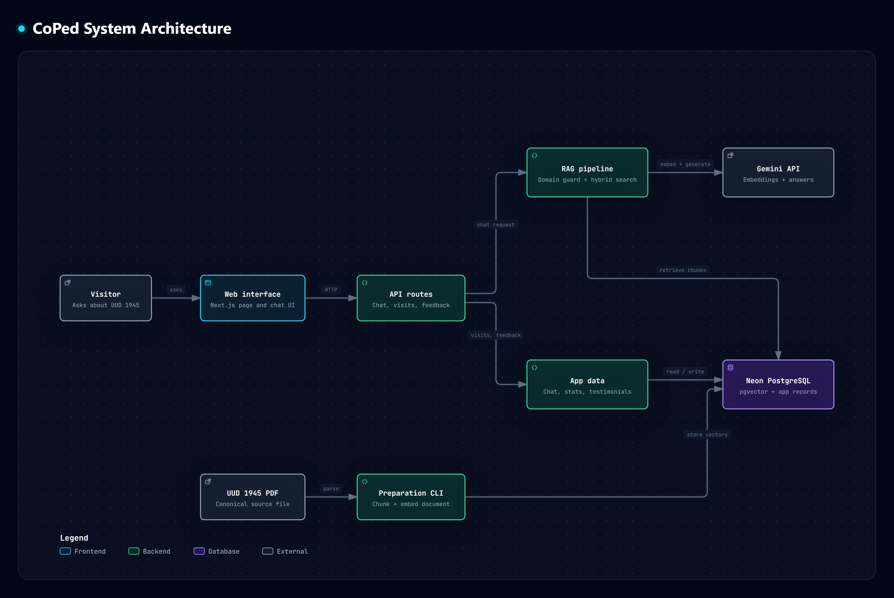

# CoPed

CoPed (Constitutional Pedia) is a learning assistant for Indonesia's 1945 Constitution (UUD 1945). It uses retrieval-augmented generation (RAG) to answer questions from the constitution's text.

## What it does

- Answers UUD 1945 questions and shows the relevant source passages, including article and paragraph references when available.
- Declines unrelated questions and reports when the indexed document has no matching context.
- Tracks visits and questions, accepts feedback, and displays reviewed testimonials and public statistics.

## Architecture



The preparation CLI parses the UUD 1945 PDF, creates chunks and Gemini embeddings, then stores them in Neon. For each chat question, the Next.js API checks the topic, retrieves relevant chunks through vector and article-reference search, and asks Gemini to generate an answer from that context.

[Explore the interactive architecture diagram](.archify/architecture-coped-20261024-153239/coped-architecture.html).

## Tech stack

- **App:** Next.js 16, React 19, TypeScript, Tailwind CSS 4
- **Data:** Neon PostgreSQL with `pgvector`, Drizzle ORM
- **AI:** Gemini API for embeddings and answer generation

## Run locally

Create `frontend/.env.local` from [`frontend/.env.example`](frontend/.env.example) and set your Neon database URL and Gemini API key. Then run:

```bash
cd frontend
npm install
npm run db:migrate
npm run ingest:uud
npm run embed:uud -- --document-id=YOUR_DOCUMENT_UUID
npm run dev
```

Use the document UUID printed by `ingest:uud`. Open `http://localhost:3000`. See [ingestion](docs/UUD_INGESTION.md) and [embedding](docs/GEMINI_EMBEDDING.md) for details.

## Copyright

© 2026 CoPed. All rights reserved.
