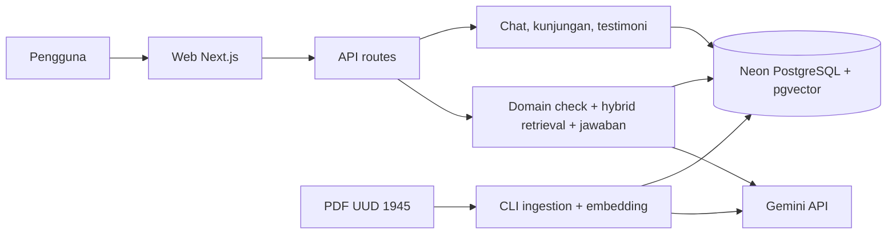

# CoPed

## Tentang

CoPed (Constitutional Pedia) membantu pengguna memahami UUD 1945 melalui tanya jawab berbasis dokumen konstitusi.

## Fitur

- Menjawab pertanyaan tentang UUD 1945 dengan rujukan pasal dan ayat yang relevan.
- Menampilkan statistik penggunaan serta menerima dan menampilkan testimoni yang telah ditinjau.

## Arsitektur

[Lihat diagram interaktif](.archify/architecture-coped-20261024-153239/coped-architecture.html).

## Tech stack

Next.js 16, React 19, TypeScript, Tailwind CSS 4, Neon PostgreSQL (`pgvector`), Drizzle ORM, dan Gemini API.

## Copyright

© 2026 CoPed. All rights reserved.
